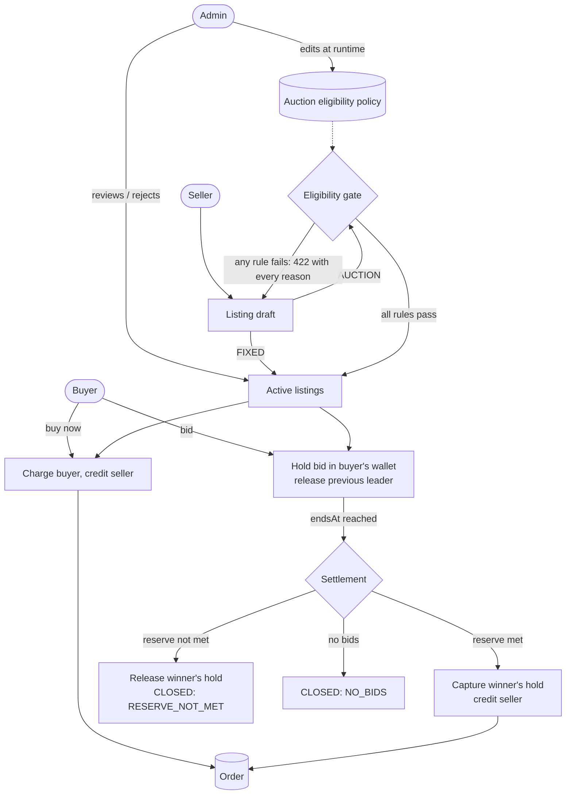

# BidBuyGo

[](https://github.com/aariyajanams-source/BidBuyGo/actions/workflows/ci.yml)

A marketplace where sellers sell at a fixed price or, when the item and seller qualify, by auction, and the winning
bid is already held in escrow when the auction closes.

## The problem

Pricing something unique or uncertain (a vintage watch, a signed print, a one-off handmade piece) is hard. A fixed
price is either too low and the seller gets burned, or too high and nothing sells. An auction lets the market find
the price, but auctions bring their own trust problems:

- **Non-paying winners.** Someone wins and then never pays, and the seller has lost the sale and the time.
- **Shill bidding.** The seller, or a friend, bids on their own item to push the price up.

What BidBuyGo does about each:

- **Non-paying winners: solved.** Every bid is backed by money. Placing a bid moves that amount from the bidder's
  wallet into a hold; being outbid releases it. When the auction closes, the hold is captured and the seller is
  credited in the same transaction, so a winner cannot walk away.
- **Shill bidding: not solved yet.** Sellers cannot bid on their own listings, but nothing detects a second account
  or a friend bidding for them. Detection is on the [roadmap](#roadmap).

Auctions are also gated: only sellers and items that pass an admin-set eligibility policy can be auctioned. Everything
else is sold at a fixed price.

## Screenshots

Live auction (polling, countdown, anti-sniping extension, bid history):


Eligibility check for a new seller, showing every failing rule at once:


## Roles and flow

There are three roles: `BUYER`, `SELLER` and `ADMIN`.



- **Fixed price:** `POST /listings/{id}/buy` charges the buyer and credits the seller in one transaction.
- **Auction:**
  - Each bid must reach `minNextBid` (the start price, then the current bid plus the policy's increment).
  - A bid in the last 30 seconds pushes the end out by 30 seconds (anti-sniping).
  - A scheduler settles due auctions every 5 seconds. Each auction settles in its own transaction, and a failed
    settlement is retried on the next pass.

## Auction eligibility rules

`EligibilityService` applies every rule below to an auction draft and returns all failures together, so a seller
sees everything to fix in one response (`422 {message, reasons}`). Fixed-price listings skip the gate. Sellers can
dry-run it with `POST /listings/check`.

| Rule | Default | Rejection reason (example) |
|---|---|---|
| Seller must be verified (can be switched off) | required | `Seller must be verified to auction` |
| Seller has at least N completed orders | 5 | `Seller needs at least 5 completed orders to auction; has 0` |
| Category is in the allowed list | collectibles, pre-owned, handmade, limited-edition, open-box | `Category 'electronics' is not auctionable; allowed: ...` |
| Condition grade is in the allowed list | NEW, LIKE_NEW, GOOD, FAIR | `Condition FAIR is not auctionable; allowed: ...` |
| At least N photos | 2 | `Auctions need at least 2 photos; got 0` |
| Reserve price at least a minimum | ₹100.00 | `Reserve price must be at least ₹100.00; got ₹50.00` |

The policy is a single database row, and admins can edit it at runtime with `PUT /admin/policy`; the next check uses
the new values. The policy also sets the minimum bid increment (default ₹10.00).

Malformed drafts are rejected earlier with `400`, also listing every problem. Examples: a missing title, a reserve
below the start price, or an end time in the past or more than 14 days away.

## Concurrency design

Many people can bid on, buy or settle the same listing at once. Every flow that touches money or bids follows one
recipe, inside a single `@Transactional` service method:

1. **Lock the listing row first** (`SELECT ... FOR UPDATE`, JPA `PESSIMISTIC_WRITE`), then re-check its status
   under the lock.
2. **Lock the wallets involved in ascending wallet id order**, always through `WalletService.lockWallets`.
3. Move the money with `hold`, `release`, `captureHeld`, `chargeAvailable` or `credit`. These refuse to run on a
   wallet that isn't locked or outside a transaction, and refuse any change that would make a balance negative.

**Why this order prevents deadlocks.** A deadlock needs two transactions that each hold a lock the other is waiting
for. Every flow takes the listing first, so two flows on the same listing queue up on that one row, and the second
can't take any wallet lock until the first commits. Flows on different listings may contend for the same wallets,
but they always lock wallets in ascending id order. A transaction holding wallet 7 and waiting for wallet 9 can never
be blocked by one holding 9 and waiting for 7, because that one would have had to take 7 first. No cycle can form.

**Wallet ledger invariant.** A wallet's `available` and `held` balances change only through ledger entries.
- `Wallet.applyDelta` is package-private, and only `WalletService.record` calls it, saving a `WalletTransaction`
  with the signed `availableDelta` and `heldDelta` at the same time.
- Replaying a wallet's rows from zero therefore reproduces its balances exactly, and the tests check this after
  every money scenario.
- Auction holds have one more rule: for each active auction, the only money held for it is `currentHighBid`, held
  from `highBidderId`.

**Unique constraints as a second line of defence.** The locks make these unreachable in normal operation, but the
database enforces them anyway:
- `orders.listing_id` is unique: one sale per listing.
- `bids (listing_id, amount_paise)` is unique: two accepted bids can't have the same amount.

**The stale-read bug we found and fixed.**
- **The problem:** if a transaction had already loaded a wallet (or listing) without a lock, a later locking query
  for the same row handed back the instance Hibernate had already cached. The row lock was taken, but the balances
  in memory were the ones read before the lock, so they could be stale.
- **The fix:** `common.persistence.Locks.ensureWriteLocked`. After a locking query, it checks the entity's lock mode.
  If the entity isn't write-locked by this transaction, it re-reads the row under `PESSIMISTIC_WRITE`.
- **Coverage:** both lock helpers use it, and `WalletLedgerTest.lockWalletsLocksAWalletAlreadyLoadedInTheTransaction`
  covers the already-loaded path.

## Money handling

Money is always an integer number of paise (`long`), in the database, the API and the code. There is no `float` or
`double` money anywhere.
- **API:** JSON amounts must be whole numbers. Jackson is configured to reject `10.5` instead of truncating it.
- **Frontend:** amounts are converted only through `formatPaise` for display and `rupeesToPaise` for input, which
  parses rupee strings with integer arithmetic.

## Security notes

- **Passwords:** hashed with BCrypt. Passwords over 72 bytes are rejected, because BCrypt would silently ignore the
  rest.
- **Authentication:** stateless JWTs (HMAC). The signing key comes from `JWT_SECRET`, and the default in
  `application.yml` is for local development only. Rules that depend on seller trust reload the user from the
  database instead of trusting token claims.
- **Authorization:** role checks via `@PreAuthorize`, with `/admin/**` also locked down at the filter level. 401 and
  403 responses use the same `{message, reasons}` JSON as every other error.
- **Hidden reserve price:** `reservePrice` is returned only to the listing's seller and to admins. Everyone else gets
  `reserveMet` and no `reservePrice` field. `ReservePrivacyTest` also checks that no bid rejection, bid response or
  bid history leaks the amount.
- **No HTML injection in the UI:** the frontend builds every element with `createElement` / `textContent`. Only
  `http(s)` URLs reach ``. `FrontendResourcesTest` fails the build if `app.js` contains `innerHTML`,
  `outerHTML`, `insertAdjacentHTML`, `document.write` or `eval(`.

> **Warning: never deploy the `dev` profile or `DEMO_MODE`.**
> - The `dev` profile (the default when no profile is set) seeds accounts with a known password (`password123`)
>   and opens the H2 console.
> - `DEMO_MODE = true` at the top of `app.js` adds one-click demo login buttons for those accounts.
> - A deployment must run with `SPRING_PROFILES_ACTIVE=postgres`, set `DEMO_MODE` to `false`, and set its own
>   `JWT_SECRET`.

## How to run

Requirements: Java 21+ with `JAVA_HOME` pointing to a JDK directory. Maven isn't needed; use the bundled wrapper.

```bash
./mvnw spring-boot:run
```

Open http://localhost:8080 for the web UI: plain HTML/CSS/JS in `src/main/resources/static`, no build step.

With no profile set, the app runs in the `dev` profile:
- in-memory H2;
- the H2 console at http://localhost:8080/h2-console (JDBC URL `jdbc:h2:mem:bidbuygo`, user `sa`, empty password);
- the seeded accounts below. The verified seller also gets 2 fixed-price and 2 auction listings.

| Email (password `password123`) | Role | Notes |
|---|---|---|
| admin@bidbuygo.dev | ADMIN | |
| seller.verified@bidbuygo.dev | SELLER | verified, 10 completed orders |
| seller.new@bidbuygo.dev | SELLER | unverified, 0 orders; fails most eligibility rules |
| buyer1@bidbuygo.dev | BUYER | wallet ₹500.00; top up to bid on the seeded auctions |
| buyer2@bidbuygo.dev | BUYER | wallet ₹500.00 |

To use Postgres instead, copy `.env.example` to `.env`, fill it in, and run with `SPRING_PROFILES_ACTIVE=postgres`.
That profile has no H2 console and no seed data.

**Windows:** if the project path contains an apostrophe (for example `C:\Users\...\AARIYA's WORKLOG\...`), `mvnw.cmd`
fails. Run `./mvnw` from Git Bash instead.

## Tests

```bash
./mvnw clean test     # unit + H2 integration tests, including the H2 concurrency proof (fast)
./mvnw clean verify   # the above, plus the Postgres concurrency proof (needs Docker; skipped without it)
```

CI runs `./mvnw -B clean verify` on every push and pull request to `main`.

### Concurrency proof

`ConcurrentBiddingProof` (in `src/test/java/com/bidbuygo/bid`) holds the test logic. Two subclasses run it:
`ConcurrentBiddingProofTest` against H2 in the test phase, and `ConcurrentBiddingProofPostgresIT` against
PostgreSQL 16 via Testcontainers in the verify phase.

**Scenario** (run 3 times per test method, each on a fresh auction):
- One auction (start ₹200, reserve ₹500) and 20 buyers, each funded with ₹800, enough for any bid.
- 200 bids are released at the same instant by a `CountDownLatch` on a 200-thread `ExecutorService`.
- Amounts are random between ₹200 and ₹800 in ₹10 steps, so many collide or lose.

**After the burst, it asserts:**
- every accepted bid is strictly higher than the one before it;
- the listing's `currentHighBid` and `highBidderId` match the highest accepted bid;
- only the leader has money held, exactly `currentHighBid`;
- no balance is negative;
- total money across all wallets is unchanged;
- every wallet's ledger replays to its balances;
- accepted plus rejected equals 200, with nothing lost, hung or failing unexpectedly.

**After settlement** (advance the clock past `endsAt`, call `closeIfDue`), it checks the same invariants again,
plus exactly one `AUCTION_WIN` order if the reserve was met (none otherwise) and nothing held for the listing.

**Results from this machine:**

| Database | Result |
|---|---|
| H2 (in-memory) | 21 of 21 scenario runs passed (7 JVM runs × 3 scenarios each) |
| PostgreSQL 16 (Testcontainers) | **Not run on this machine: skipped, because Docker isn't installed.** GitHub's Ubuntu runners include Docker, so CI should run it. No CI result has been recorded yet. |

The three H2 runs from one `./mvnw clean verify`:

```
[ConcurrentBiddingProof] db=H2 run=1 bids=200 accepted=4 rejected=196 winner=user#138 finalBid=80000 paise reserveMet=true close=SOLD
[ConcurrentBiddingProof] db=H2 run=2 bids=200 accepted=5 rejected=195 winner=user#172 finalBid=80000 paise reserveMet=true close=SOLD
[ConcurrentBiddingProof] db=H2 run=3 bids=200 accepted=5 rejected=195 winner=user#178 finalBid=80000 paise reserveMet=true close=SOLD
```

Across all 21 H2 runs:
- 2 to 8 bids were accepted and 192 to 198 rejected as too low.
- Every run sold at ₹800.00, the highest possible amount, since 200 random draws from 61 values almost always
  include the top one.
- The reserve-not-met path is therefore not exercised by this test; `AuctionSettlementTest` covers it.

## API

Errors are JSON: `{"message": "...", "reasons": ["..."]}`. Status codes:
- **400:** malformed or invalid input;
- **401 / 403:** missing token, or the wrong role;
- **404:** not found;
- **409:** a state conflict (for example, a listing that is no longer active);
- **422:** valid input that a business rule rejects (for example, auction eligibility).

| Method | Path | Auth | Purpose |
|---|---|---|---|
| POST | /auth/register | public | `{email, password, role}`; role is BUYER or SELLER |
| POST | /auth/login | public | `{email, password}` → `{accessToken, tokenType, expiresInSeconds}` |
| GET | /me | bearer | Current user |
| GET | /wallet | bearer | Current user's balances (paise) |
| POST | /wallet/topup | bearer | `{amount}` in paise, 1 to 10,000,000 (simulated, no payment gateway) |
| GET | /listings | public | ACTIVE listings; optional `?type=FIXED\|AUCTION&category=` |
| GET | /listings/{id} | public | One listing (REJECTED only for its seller or an admin) |
| POST | /listings | SELLER | Create; 400 if invalid, 422 if an auction isn't eligible |
| POST | /listings/check | SELLER | Same body as create; returns `{eligible, reasons}` and saves nothing |
| POST | /listings/{id}/buy | BUYER, SELLER | Buy a fixed-price listing |
| POST | /listings/{id}/bids | BUYER, SELLER | `{amount}` in paise; returns the bid plus `endsAt` and `extended` |
| GET | /listings/{id}/bids | public | Accepted bids, newest first, bidder email masked |
| GET | /orders/mine | bearer | Orders where you are buyer or seller, with `role` |
| GET / PUT | /admin/policy | ADMIN | Auction eligibility policy |
| GET | /admin/listings | ADMIN | All listings; optional `?status=` |
| POST | /admin/listings/{id}/reject | ADMIN | `{reason}`; ACTIVE listings without bids only |
| GET | /admin/ping | ADMIN | Health check for admin access |

Listing responses (`GET /listings`, `GET /listings/{id}`, `GET /admin/listings`, `POST /listings` and the reject
response) include:
- **`minNextBid`** (paise): the lowest bid that would be accepted right now. It is `null` for fixed listings and
  for auctions that aren't open for bids.
- **`reserveMet`**: true once the leading bid reaches the reserve; `null` for fixed listings.
- **`reservePrice`**: only for the listing's seller and admins.

## Project structure

Package-by-feature under `src/main/java/com/bidbuygo`:

| Package | Contents |
|---|---|
| `auth` | Registration, login, JWT filter, security config |
| `user` | Users, roles, `/me`, atomic completed-orders counter |
| `wallet` | Wallets, the ledger (`WalletTransaction`), lock helpers, hold/release/capture/charge/credit |
| `listing` | Listings, draft validation, listing responses (`minNextBid`, reserve privacy), admin review |
| `policy` | The auction eligibility policy, its seeder and `EligibilityService` |
| `bid` | Bid placement (holds, outbid release, anti-sniping) and bid history |
| `auction` | Settlement (`AuctionSettlementService`), the close job and its scheduler |
| `order` | Buy-now and auction-win orders |
| `dev` | Dev-profile seed data |
| `common` | Error handling, money formatting, lock helpers, the injectable `Clock` |

Also:
- `src/main/resources/static`: the web UI (`index.html`, `app.js`, `style.css`).
- `src/test/java/com/bidbuygo`: tests mirroring the packages, plus `support` (fixtures, a shared Spring context
  annotation, a controllable clock, a thread-race helper).
- `.github/workflows/ci.yml`: CI.

## Roadmap

None of the following is built yet:

- **WebSockets** to push bid updates, replacing the UI's 2-second polling.
- **Dutch auctions with auto-markdown**, to clear dead stock by lowering the price over time.
- **Shill-bid detection**, flagging suspicious bidding patterns between related accounts.
- **Proxy bidding**: bid automatically up to a buyer's maximum.
- **Backoff and dead-letter handling** for settlements that fail repeatedly. Today a failed settlement is logged
  and retried on every pass.
- **A payment gateway**, replacing simulated wallet top-ups.

## Image credits

The dev seed listings (`dev.DevDataSeeder`) show these photos from Wikimedia Commons. They are hotlinked
from `upload.wikimedia.org` as 960px thumbnails, not stored in this repository. Authors and licences are as
stated on each file's Commons page.

| Listing | Title | Author | Licence |
|---|---|---|---|
| Vintage Polaroid SX-70 camera | [Polaroid SX-70 (4462345243)](https://commons.wikimedia.org/wiki/File:Polaroid_SX-70_%284462345243%29.jpg) | Thomas Backa | [CC0 1.0](https://creativecommons.org/publicdomain/zero/1.0/) |
| Vintage Polaroid SX-70 camera | [Polaroid SX-70 camera](https://commons.wikimedia.org/wiki/File:Polaroid_SX-70_camera.jpg) | Michael Gatchell | [CC BY 2.0](https://creativecommons.org/licenses/by/2.0/) |
| Handwoven jute tote bag | [Baghashtag-Jute-bag](https://commons.wikimedia.org/wiki/File:Baghashtag-Jute-bag.jpg) | Efkanakbiyik | [CC0 1.0](https://creativecommons.org/publicdomain/zero/1.0/) |
| Handwoven jute tote bag | [Jute Bag](https://commons.wikimedia.org/wiki/File:Jute_Bag.JPG) | Fahad Faisal | [CC BY-SA 3.0](https://creativecommons.org/licenses/by-sa/3.0/) |
| Signed 2011 World Cup cricket ball | [GandM Purist 156g cricket ball n01](https://commons.wikimedia.org/wiki/File:GandM_Purist_156g_cricket_ball_n01.jpg) | Marie-Lan Nguyen | [CC BY 2.5](https://creativecommons.org/licenses/by/2.5/) |
| Signed 2011 World Cup cricket ball | [GandM Purist-Grace match cricket balls](https://commons.wikimedia.org/wiki/File:GandM_Purist-Grace_match_cricket_balls.jpg) | Marie-Lan Nguyen | [CC BY 2.5](https://creativecommons.org/licenses/by/2.5/) |
| Limited-edition art print (12/50) | [Coy Avon Seward - lithograph from an edition of 200 is signed and dated 1936 by the artist in pencil lower right and titled Adobe Village - New Mexico lower left](https://commons.wikimedia.org/wiki/File:Coy_Avon_Seward_-_lithograph_from_an_edition_of_200_is_signed_and_dated_1936_by_the_artist_in_pencil_lower_right_and_titled_Adobe_Village_-_New_Mexico_lower_left.jpg) | Coy Avon Seward | Public domain |
| Limited-edition art print (12/50) | [Framed Print](https://commons.wikimedia.org/wiki/File:Framed_Print_MET_frame_1991.219.1.jpg) | The Metropolitan Museum of Art (no individual author listed) | [CC0 1.0](https://creativecommons.org/publicdomain/zero/1.0/) |

The photos are not modified, apart from Wikimedia's own resizing to thumbnails. They show similar items, not the
exact seeded ones: the cricket balls are plain match balls, not a signed 2011 World Cup ball, and the art prints
are lithographs, not giclée prints.
